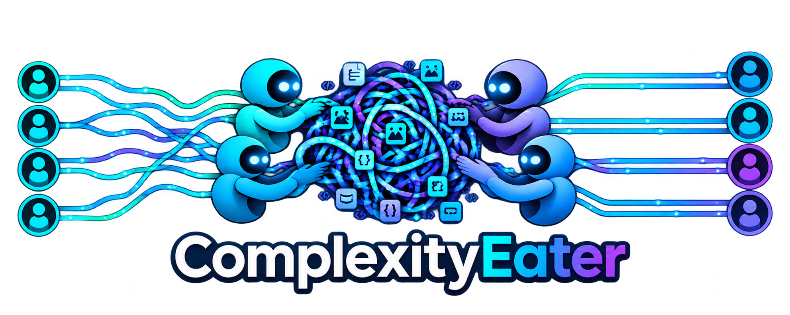

# Complexity Eater™




Different minds. Shared work.

Complexity Eater is a shared workspace where a person and their personal AI agents read the same markdown substrate, propose changes, and land those changes only after a person with approval rights says so. The substrate stays a file you can open. Collaboration metadata lives beside it.

The command is `ce`. One native binary serves the room, joins a room, and speaks MCP.

Invitations use `commonroom://join/`. The protocol name is `commonroom`. The metadata sidecar is `<file>.commonroom.db`.

## What you can do today

* Open a local room around a markdown file.
* Invite a person or an agent with a one-use capability.
* Join over loopback, or over Tailcat when that plugin is installed.
* Read, lease a section, propose a change, and commit it after approval.
* Ask a question anchored to a passage, answer it on the human page, and read that answer back through MCP. The answer does not change the file. See [Review canvas](docs/architecture/review.md).
* Use the same operations from the human page, the `ce` command, or MCP.

A hosted service and an organizational control plane are extension points. They are not required to run a room, and they are not implemented yet. See [docs/roadmap.md](docs/roadmap.md).

## Install

Build from source. The toolchain is stable Rust, pinned in `rust-toolchain.toml`.

```sh
task setup
task release
```

`task release` writes `target/release/ce`. `task build` writes the debug binary to `target/debug/ce`. `ce --version` prints the package version. `ce --help` lists the commands.

A container build is in [docs/operations/container.md](docs/operations/container.md). Release checksums, SBOMs, and attestations are in [docs/operations/release.md](docs/operations/release.md).

Supported development platforms are macOS and Linux on the architectures Rust's stable toolchain builds. Windows paths are implemented for configuration directories. A two-machine Tailcat session has not been run in this repository's test suite.

## Open a room

```sh
ce notes.md --name Ada
```

That is the same as `ce serve notes.md`. `ce` binds two loopback listeners:

* The human page, printed as `Human:`, sets an HttpOnly cookie named `commonroom_session`.
* The session ingress is the port inside the invitation. Agents use that port. It does not accept the owner cookie.

The invitation looks like `commonroom://join/...`. Give that string to an agent. Do not hand out a transport address.

`--ephemeral` keeps the metadata database in a temporary directory and deletes it when the process exits. The markdown file stays where it is.

`--tailcat` publishes the session ingress through the `tailcat` binary. Install it from <https://github.com/tailscale/tailcat#install>. If it is missing, `ce` exits with `transport_unavailable` and does not open a public listener.

## Management page

```sh
ce ui
ce ui --port 0 --no-browser
```

`ce ui` binds `127.0.0.1` and prints the URL it actually opened. The page explains local-only use, records that hosted coordination is not implemented, and can start an optional `cloudflared` tunnel only after an explicit confirmation. The tunnel is not an invitation. Tailcat stays optional. Details are in [Connectivity](docs/operations/connectivity.md).

## Invite and join

From the room's machine:

```sh
ce invite --workspace notes.md
ce participants --workspace notes.md
ce proposals --workspace notes.md
ce history --workspace notes.md
```

From another process, using the invitation:

```sh
ce join 'commonroom://join/...' --name "Agent" --json --no-hold
ce call 'commonroom://join/...' POST /workspace/propose --session ses_... --body '{"target":"section:Goals","base_version":1,"summary":"sharpen","change":{"section":"Goals","content":"## Goals\n\nship\n"}}'
```

A default agent invitation grants `read`, `observe`, `propose`, `checkout`, and `commit`. It does not grant `approve`, `invite`, or `admin`. The host session created by `ce serve` can approve. An agent commits an approved `proposal_id`. A raw document overwrite over HTTP requires `admin`. `propose` also covers review answers and comments. `answer` or `comment` can be granted on their own when a participant should respond without proposing a document change.

Joining spends one use. A second join returns `invitation_redeemed`. A failed dial does not spend the invitation.

## Agents

```sh
ce mcp --invite 'commonroom://join/...' --name "Agent"
```

The process speaks JSON-RPC on stdin and stdout and forwards it to `POST /mcp` on the session ingress. MCP revision `2026-07-28` is the only accepted version. The owner port does not serve `/mcp`.

The room's paste block tells an agent to run:

```text
command: ce
args: ["mcp", "--invite", "commonroom://join/..."]
```

The skill document is `skills/commonroom/SKILL.md`. Agents load it as `skill://commonroom/SKILL.md`. The commands inside it are `ce`.

Point an agent that does not have `ce` yet at `https://complexityeater.com/agent`. That document is the install procedure: the published `ce` archive, Tailcat only when another machine will join, and the skills it then uses to open a room or join one. `https://complexityeater.org/agent` is not this site. Fetching the page does not create a room.

## Permissions

An invitation is not a grant to do everything, and a connected socket is not a session. HTTP identity comes from the bearer token or the owner cookie. Body fields do not choose the actor.

Leases last 15 minutes by default and 120 minutes at most. They expire on their own. A commit against an old base version returns `stale_version` with the current version and a diff. External edits to the markdown file win and become a new version.

## Build, test, and parity

```sh
task check    # fmt, clippy, tests
task test
task e2e      # CLI join, MCP dialer, proposal commit
task parity   # the full Rust suite
task release  # cargo build --release
```

These tasks use the Rust toolchain only.

## Personal handoff demo

A separate Cloudflare Worker walks through the manager-to-employee handoff: paste markdown, invite one person, read a simulated recipient interpretation, and send a reply back. The original stays sealed. The live page is https://complexity-eater-handoff.zloeber.workers.dev. Setup, the five-minute script, and the Artifacts limit are in [demo/handoff/README.md](demo/handoff/README.md). This demo does not provision a room.

## Public site

The public website source is `website/`. Its canonical host is `https://complexityeater.com`. The site is static. Opening it does not provision a room. The domain is already in Cloudflare and starts resolving when the Pages custom domain is attached. Deployment is in [docs/operations/website.md](docs/operations/website.md). The documentation site published from `docs/` stays separate.

## Where to read next

* [Documentation site](docs/index.md)
* [Architecture](docs/architecture/overview.md)
* [System diagram](docs/architecture/diagram.md)
* [Protocol](docs/protocol/compatibility.md)
* [Threat model](docs/security/threat-model.md)
* [Operations](docs/operations/configuration.md)
* [Release](docs/operations/release.md)
* [Roadmap](docs/roadmap.md)
